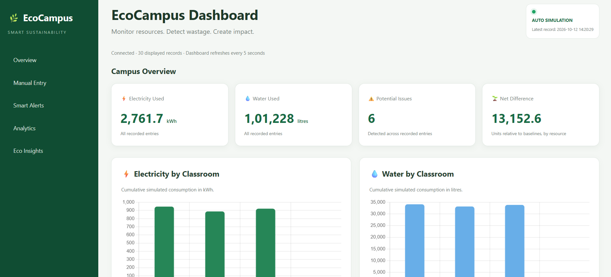
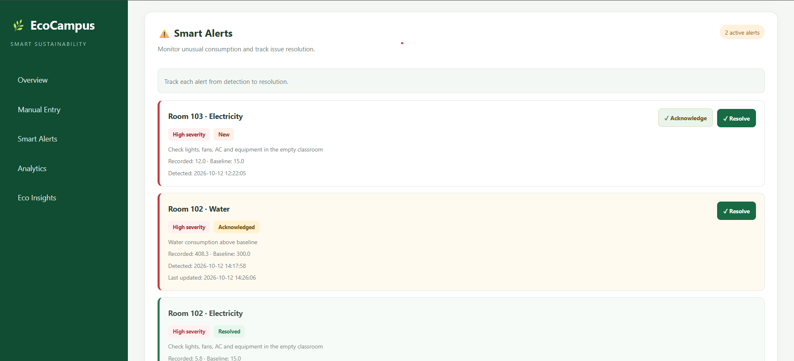

# 🌱 EcoCampus — Smart Campus Sustainability Dashboard

**Monitor campus resource consumption, detect wastage, and promote sustainable resource usage.**

EcoCampus is a software-based sustainability dashboard designed to help colleges monitor electricity and water consumption across classrooms. It uses simulated and manually entered resource readings, historical tracking, and smart alerts to make campus resource consumption more visible and actionable.

## 🎯 Problem Statement

Resource wastage—whether water, electricity, or materials—often goes unnoticed when consumption is not tracked in a way people can act on.

EcoCampus aims to help classrooms and campuses understand resource usage, identify potential wastage, and support more sustainable decisions.

## 💡 Our Solution

EcoCampus provides a centralized dashboard that displays classroom resource usage, compares readings against configured baselines, and generates alerts when unusual consumption is detected.

The current MVP uses simulated readings and manual entries to demonstrate the core functionality without requiring physical IoT hardware.

## ✨ Key Features

- 📊 **Live Dashboard:** View electricity and water resource readings.
- 🔄 **Automatic Simulation:** Generate demonstration readings at regular intervals.
- 🚨 **Smart Alerts:** Flag above-baseline consumption and electricity usage in unoccupied classrooms.
- ✅ **Alert Management:** Acknowledge alerts and mark issues as resolved.
- 📈 **Sustainability Reports:** Review usage over the last 24 hours, 7 days, or 30 days.
- 📉 **Usage Trends:** Compare average consumption against configured baselines.
- 🏫 **Classroom Monitoring:** Compare average and peak resource readings across classrooms.
- 📥 **CSV Export:** Download sustainability report data.
- 🗄️ **Historical Tracking:** Store readings for reporting and analysis.
- ✍️ **Manual Entry:** Record resource readings through the dashboard.

## 🛠️ Technology Stack

- **Frontend:** HTML, CSS, JavaScript
- **Backend:** Python, Flask
- **Database:** SQLite
- **Version Control:** Git and GitHub

## ⚙️ How It Works

1. Resource readings are generated by the simulation or entered manually.
2. Flask stores resource readings and historical records in SQLite.
3. The alert system checks readings against configured conditions.
4. The dashboard retrieves and displays current resource data.
5. Sustainability reports summarize historical readings for the selected period.
6. Users can compare classrooms, inspect trends, and export report data as CSV.

## 🚀 Getting Started

### Prerequisites

- Python 3.10 or newer recommended
- pip
- Git (optional)

### Installation

**1. Clone the repository**

```bash
git clone https://github.com/yashparmar2680/kaushal-8.0-hackathon.git
cd kaushal-8.0-hackathon
```

**2. Create a virtual environment (recommended)**

```bash
python -m venv venv
```

Activate it on Windows:

```bash
venv\Scripts\activate
```

**3. Install dependencies**

```bash
pip install -r requirements.txt
```

**4. Run the application**

```bash
python app.py
```

**5. Open the dashboard**

Visit: http://127.0.0.1:5000

The application initializes its SQLite database and starts the demonstration simulation when launched.

## 📸 Project Screenshots

Add screenshots of the actual running application to the `screenshots/` directory.

### Dashboard



### Smart Alerts



### Sustainability Reports


> Ensure the screenshot files exist at the paths above; otherwise, GitHub will display broken image links.

## 🧪 Current MVP Scope

- Classroom electricity and water resource monitoring.
- Automatically generated demonstration readings.
- Manual resource entry.
- Alert generation and alert management.
- Historical resource tracking in SQLite.
- Sustainability reports with configurable time ranges.
- Classroom comparison and CSV export.

**Data transparency:** The current MVP uses simulated readings and manual entries. It does not claim to collect measurements from installed physical IoT sensors. Simulated readings are intended for demonstration and testing.

## 🔮 Future Improvements

- Integrate physical IoT sensors for live electricity and water measurements.
- Use suitable occupancy sensors to estimate classroom occupancy.
- Add carbon-emissions estimates using a documented, configurable emissions factor.
- Introduce role-based access for administrators and facility managers.
- Add campus-wide sustainability goals and data-informed resource-saving recommendations.

### Potential Future IoT Integration

- **PZEM-004T energy meter:** Electricity measurements, subject to electrical compatibility.
- **YF-S201 water flow sensor:** Water flow measurements.
- **HC-SR501 PIR sensor:** Movement-based occupancy estimation.
- **ESP32 Wi-Fi microcontroller:** Collect and transmit sensor readings.
- **Modbus/RS485 meters:** Potential integration with compatible campus metering equipment.

These components are proposed future integrations, not hardware currently installed in the MVP.

## 🌿 Expected Impact

EcoCampus aims to help educational institutions identify potential resource wastage, improve awareness of electricity and water consumption, and support data-informed sustainability decisions.

## 👨‍💻 Built For

**KAUSHAL 8.0 Hackathon — PS-04**

A software-based MVP focused on campus sustainability and responsible resource management.

---

*EcoCampus — Small insights, smarter campuses, a greener future.*
